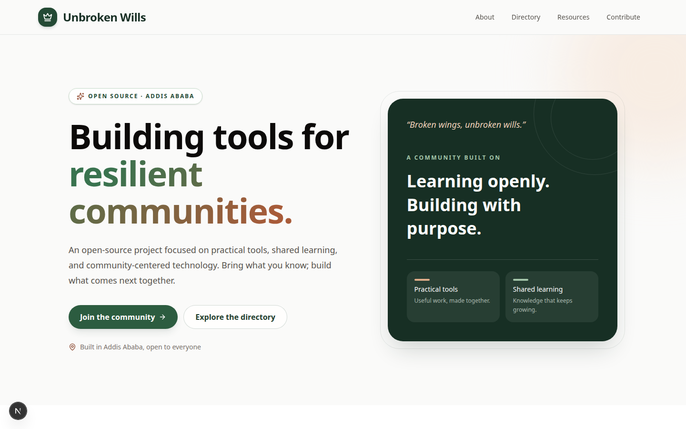

# Unbroken Wills

*"Broken wings, unbroken wills."*

Unbroken Wills is an open-source project created in Addis Ababa, Ethiopia. We build practical digital tools, share learning resources, and make space for students, developers, designers, writers, testers, and community builders to learn and contribute together.

## Homepage Preview

## Table of Contents

- [Project Pillars](#project-pillars)
- [Directory Profiles](#directory-profiles)
- [Share a Resource](#share-a-resource)
- [Tech Stack](#tech-stack)
- [Roadmap](#roadmap)
- [Run Locally](#run-locally)
- [Contributing](#contributing)
- [Maintainer and Contact](#maintainer-and-contact)
- [License](#license)

## Project Pillars

- **Technology:** Learning, building, and sharing open-source tools for students, developers, and future technologists.
- **Tools & Records:** Creating simple digital tools for organizing budgets, reports, logs, and everyday operational tasks.
- **Community & Learning:** Building a respectful space where people can share knowledge, support one another, and collaborate on open-source projects.

## Directory Profiles

The directory features real community members who have chosen to share their public-safe details.

To join the directory:

1. Go to the [Issues](https://github.com/abigiya-getachew/unbroken-wills-hub/issues) tab.
2. Click **New issue**.
3. Choose **Profile Submission**.
4. Share only the details you want public and confirm consent.

For edits or removal, open a **Profile Removal or Edit Request** issue. Never include private or sensitive information, such as phone numbers, home addresses, ID numbers, passwords, or personal documents.

## Share a Resource

Have a useful guide, template, checklist, code snippet, or community resource? You can share it without making a code change:

1. Open [GitHub Issues](https://github.com/abigiya-getachew/unbroken-wills-hub/issues) and click **New issue**.
2. Choose **Resource Submission** and fill in the form.
3. For a file, provide a public link or attach it in a comment after submitting.
4. A maintainer will review it before publication.

Only share resources you created or have permission to share. Do not submit sensitive or private information, harmful or executable files, archives, or copyrighted material without permission.

## Tech Stack

- **Framework:** Next.js with React
- **Styling:** Tailwind CSS v4
- **Icons:** Lucide

## Roadmap

We plan to keep growing the project in ways that support the community:

- Welcome more learners and builders to the community directory.
- Expand shared learning resources and practical tools.
- Make it easier for new contributors to find a welcoming first contribution.
- Continue improving accessibility and the experience across devices.

Have an idea or want to help? Browse [open issues](https://github.com/abigiya-getachew/unbroken-wills-hub/issues) or suggest one.

## Run Locally

1. Clone the repository: `git clone https://github.com/abigiya-getachew/unbroken-wills-hub.git`
2. Navigate to the folder: `cd unbroken-wills-hub`
3. Install dependencies: `npm install`
4. Run the app: `npm run dev`

## Contributing

There are many ways to help: developers can contribute code; designers can improve usability and accessibility; writers can create documentation and learning resources; testers can report bugs; and mentors can help newcomers get started. Share a profile or resource using the steps above, or read the [Contributing Guidelines](CONTRIBUTING.md) to make a code contribution.

## 💬 Join the Discussion
Have ideas, questions, or just want to say hi? 
→ [Start a conversation in Discussions](https://github.com/abigiya-getachew/unbroken-wills-hub/discussions)

- 👋 Introduce yourself
- 💡 Share ideas & feedback
- ❓ Ask for help or clarification
- 🤝 Connect with fellow contributors

## Maintainer and Contact

This project is maintained by [Abigiya Getachew](https://github.com/abigiya-getachew). For a direct contact, visit the maintainer's [GitHub profile](https://github.com/abigiya-getachew); for project questions, ideas, or contribution help, [open an issue](https://github.com/abigiya-getachew/unbroken-wills-hub/issues).

## License

This project is licensed under the [MIT License](LICENSE).
